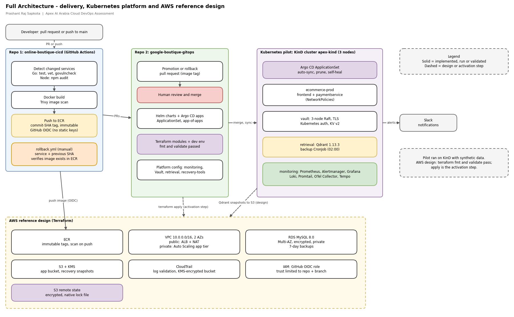
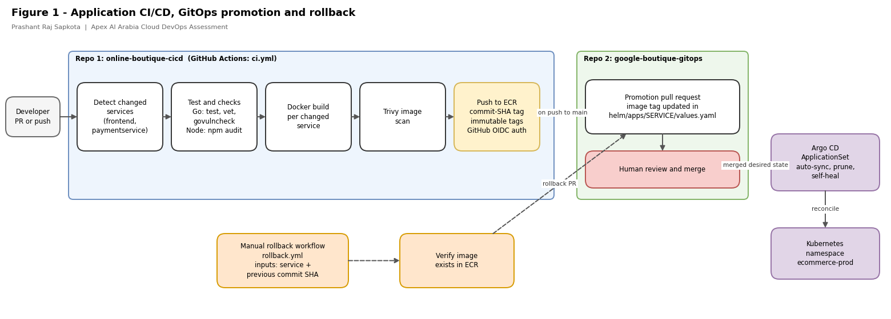
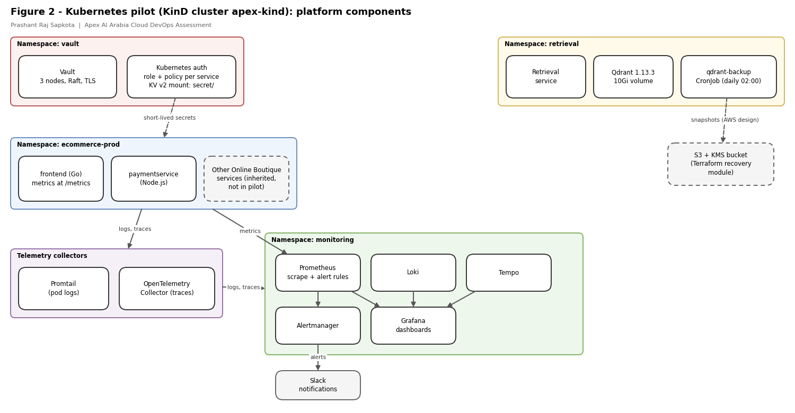
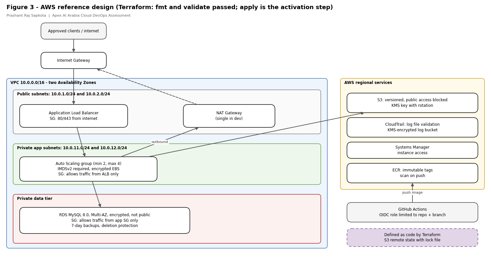
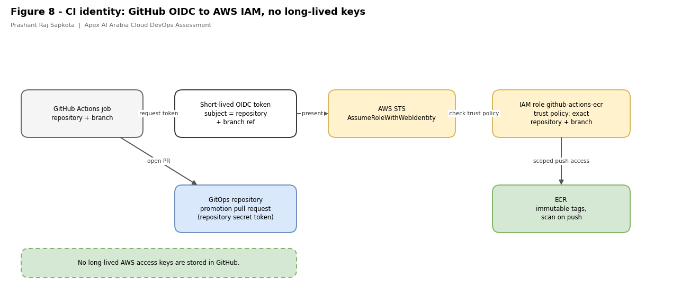
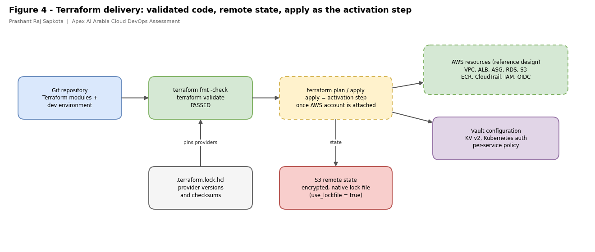
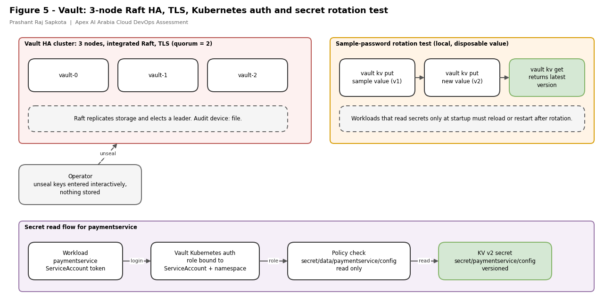
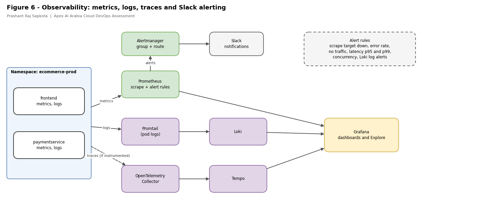
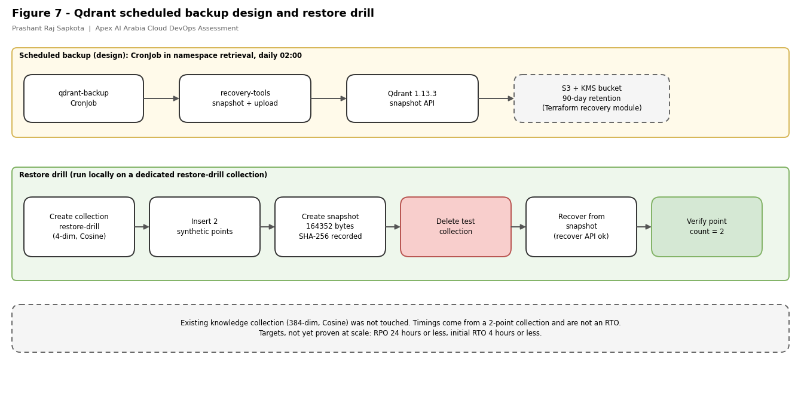
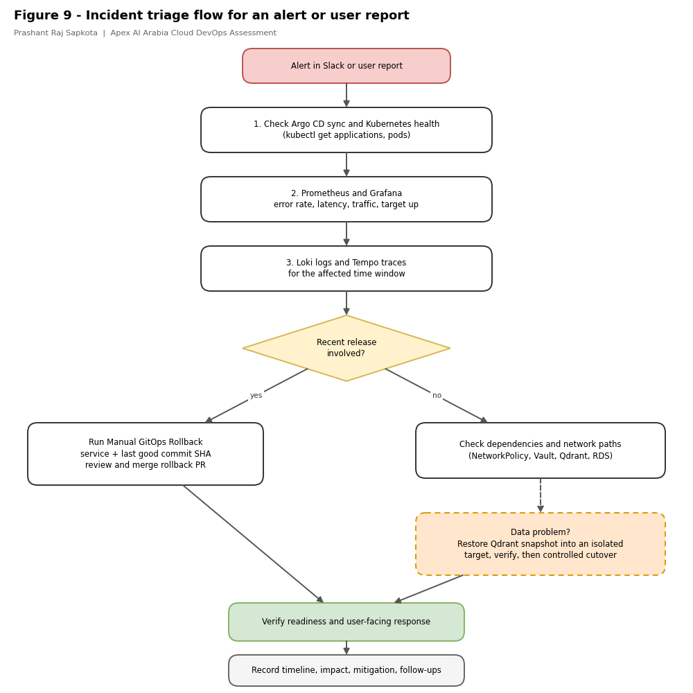

# Apex AI Arabia: Cloud / DevOps Engineer Assessment

**Candidate:** Prashant Raj Sapkota
**Role:** Jr. Cloud / DevOps Engineer
**Submission archive:** `Apex_CloudDevOps_PrashantRajSapkota.zip`

---

## Contents

1. [Executive summary](#1-executive-summary)
2. [Status at a glance](#2-status-at-a-glance)
3. [How to review this in 60 minutes](#3-how-to-review-this-in-60-minutes)
4. [Assumptions and scenario mapping](#4-assumptions-and-scenario-mapping)
5. [Architecture and diagram index](#5-architecture-and-diagram-index)
6. [Repositories and artifact inventory](#6-repositories-and-artifact-inventory)
7. [CI/CD, GitOps and rollback](#7-cicd-gitops-and-rollback)
8. [Terraform and the AWS reference design](#8-terraform-and-the-aws-reference-design)
9. [Secrets management with Vault](#9-secrets-management-with-vault)
10. [Observability and alerting](#10-observability-and-alerting)
11. [Qdrant retrieval layer, backup and restore drill](#11-qdrant-retrieval-layer-backup-and-restore-drill)
12. [Operations: SLOs, incident response, DR, cost, handover](#12-operations-slos-incident-response-dr-cost-handover)
13. [Security controls](#13-security-controls)
14. [Saudi data residency and a stricter customer](#14-saudi-data-residency-and-a-stricter-customer)
15. [Roadmap and next steps](#15-roadmap-and-next-steps)
16. [Setup and review commands](#16-setup-and-review-commands)
17. [AI tool use disclosure](#17-ai-tool-use-disclosure)

---

## 1. Executive summary

This submission is a production-oriented delivery pattern for an enterprise AI assistant platform. It covers application CI/CD, GitOps deployment, infrastructure as code, secrets management, observability, and recovery of a vector database.

I used **Google Online Boutique** as a stand-in microservice workload. **`frontend`** (Go) and **`paymentservice`** (Node.js) are the two services taken through the full delivery path. The work is split across two repositories, mirroring how a platform team separates application delivery from platform state:

| Repository | Purpose |
|---|---|
| **`google-boutique-gitops`** | Terraform, Helm charts, Argo CD configuration, Vault, observability, retrieval layer, recovery tooling |
| **`online-boutique-cicd`** | Application source, Dockerfiles, CI checks, image build and scan, GitOps promotion and rollback workflows |

**What was run.** The Kubernetes platform ran on a three-node KinD cluster named `apex-kind` (one control plane, two workers). On it I ran Argo CD, Helm applications, Prometheus with Alertmanager and Slack routing, Loki, Tempo, Vault (3-node Raft with TLS) and Qdrant, and I tested a Vault sample-password lifecycle and a Qdrant snapshot, delete and restore drill.

**Infrastructure as code.** The AWS Terraform (VPC, ALB, Auto Scaling, RDS, S3, ECR, CloudTrail, IAM and OIDC, Vault, recovery) passes `terraform fmt` and `terraform validate`. `terraform apply` is the remaining activation step, performed when the target AWS account is attached. The same modules, variables and remote-state configuration are used for that step, so the cloud environment is created from the reviewed code without changes.

**CI/CD.** The GitHub Actions workflows are complete and wired end to end: change detection, tests, vulnerability scanning, image build, ECR publishing through GitHub OIDC, a promotion pull request into the GitOps repository, and a manual rollback workflow. ECR publishing is activated by the AWS account settings (role ARN, account ID and region) in the workflow environment.

---

## 2. Status at a glance

| Area | Status |
|---|---|
| KinD cluster, Argo CD, Helm applications | Run, screenshots in `evidence/` |
| Prometheus scrape targets, frontend alert rules, Alertmanager to Slack | Run, FIRING and RESOLVED messages in Slack |
| Qdrant snapshot, **delete**, restore, verification | Run on a dedicated synthetic collection |
| Vault 3-node Raft, TLS, Kubernetes auth, KV v2 sample-password write, update and read | Run |
| Terraform `fmt` and `validate` | **Passed** |
| Terraform `apply` | Activation step, performed when the AWS account is attached |
| CI/CD workflows (CI, promotion PR, rollback) | Implemented end to end |
| Worker process from the brief | Planned (section 15) |
| Separate staging and production environments | Planned (section 15). One Terraform `dev` environment and one Kubernetes namespace today |

---

## 3. How to review this in 60 minutes

| Minutes | Read | Location |
|---|---|---|
| 0-10 | Sections 1-5 of this README and the diagrams | here, `diagrams/png/` |
| 10-25 | Terraform environment and modules | `google-boutique-gitops/terraform/` |
| 25-35 | CI and rollback workflows | `online-boutique-cicd/.github/workflows/` |
| 35-45 | Helm, Argo CD, Vault configuration | `google-boutique-gitops/helm`, `applications`, `terraform/environments/dev/vault.tf` |
| 45-55 | Alert rules, backup tooling, evidence | `platform/monitoring`, `platform/retrieval`, `recovery-tools`, `evidence/` |
| 55-60 | Roadmap (section 15) | here |

---

## 4. Assumptions and scenario mapping

The brief describes an AI assistant platform with an API, retrieval service, worker, vector store, relational storage, object storage and observability. I did not have the real application, so I built the platform pieces around a stand-in workload.

| Brief component | What I used | Notes |
|---|---|---|
| API service | `frontend` (Go) | HTTP service exposing Prometheus metrics |
| Sensitive backend service | `paymentservice` (Node.js) | Stands in for a service needing strict secrets handling and network isolation |
| Retrieval service and vector store | Retrieval service plus **Qdrant 1.13.3** | `knowledge` collection: 384 dimensions, Cosine |
| Worker | Planned | A queue-driven Deployment on the same Helm chart pattern, with its own ServiceAccount, Vault role and NetworkPolicy |
| Relational storage | Amazon RDS MySQL 8.0 (Terraform) | Private, encrypted, Multi-AZ |
| Object storage | S3 with KMS (Terraform) | Versioned, public access blocked |
| Observability | Prometheus, Alertmanager, Grafana, Loki, Promtail, OpenTelemetry Collector, Tempo | Slack alert routing |

**Assumptions and how they shaped the design**

1. **Cloud-neutral Kubernetes layer plus an AWS infrastructure layer.** Helm, Argo CD, Vault and Prometheus behave the same on any provider. Only the infrastructure modules change per cloud.
2. **Synthetic data only.** No customer, patient or employee data is used.
3. **Region is a variable.** The example uses `us-west-2`, which is where my test state bucket lives. It is not a residency claim. Section 14 covers the Saudi position.
4. **One environment in code.** Terraform has a single `dev` environment composed from reusable modules. The Kubernetes namespace name `ecommerce-prod` is a manifest naming choice and does not mean a separate AWS production environment exists.
5. **Cost-aware dev sizing.** One NAT Gateway and small instance classes. Production should weigh one NAT per Availability Zone.
6. **No long-lived cloud keys.** CI authenticates to AWS with GitHub OIDC.

---

## 5. Architecture and diagram index

All diagrams are editable draw.io files. To edit one, open [app.diagrams.net](https://app.diagrams.net), choose **File > Open from > Device** and pick the `.drawio` file (or **Extras > Edit Diagram** and paste the file contents). PNG exports are in `diagrams/png/`.

| # | Diagram | Editable source | PNG |
|---|---|---|---|
| 0 | **Full architecture (start here)** | `diagrams/drawio/00-full-architecture.drawio` | `diagrams/png/00-full-architecture.png` |
| 1 | CI/CD, GitOps promotion and rollback | `diagrams/drawio/01-delivery-flow.drawio` | `diagrams/png/01-delivery-flow.png` |
| 2 | Kubernetes platform components | `diagrams/drawio/02-platform-components.drawio` | `diagrams/png/02-platform-components.png` |
| 3 | AWS reference design (VPC) | `diagrams/drawio/03-aws-vpc-reference.drawio` | `diagrams/png/03-aws-vpc-reference.png` |
| 4 | Terraform delivery and state | `diagrams/drawio/04-terraform-delivery.drawio` | `diagrams/png/04-terraform-delivery.png` |
| 5 | Vault HA, auth and rotation test | `diagrams/drawio/05-vault-ha-and-secrets.drawio` | `diagrams/png/05-vault-ha-and-secrets.png` |
| 6 | Observability and alerting | `diagrams/drawio/06-observability-and-alerting.drawio` | `diagrams/png/06-observability-and-alerting.png` |
| 7 | Qdrant backup and restore drill | `diagrams/drawio/07-qdrant-backup-and-restore.drawio` | `diagrams/png/07-qdrant-backup-and-restore.png` |
| 8 | GitHub OIDC identity to AWS | `diagrams/drawio/08-github-oidc-identity.drawio` | `diagrams/png/08-github-oidc-identity.png` |
| 9 | Incident triage flow | `diagrams/drawio/09-incident-triage.drawio` | `diagrams/png/09-incident-triage.png` |

### 5.0 Full architecture



One view of the whole submission: developer to CI (Repo 1), reviewed promotion into the GitOps repository (Repo 2), Argo CD reconciling the Kubernetes pilot, and the AWS reference design that Terraform defines. The figures below zoom into each part.

### 5.1 Delivery flow



A change is tested, built, scanned and pushed as an image tagged with the commit SHA. CI then opens a pull request in the GitOps repository to update the image tag. A person reviews and merges it. Argo CD reconciles the merged state into Kubernetes. Rollback uses the same path.

### 5.2 Platform components



Workloads, secrets, monitoring, telemetry collection and retrieval live in separate namespaces. Vault issues short-lived secrets through Kubernetes authentication. Prometheus, Loki and Tempo feed Grafana, and Alertmanager routes alerts to Slack.

### 5.3 AWS reference design



Public subnets hold only the load balancer and NAT Gateway. Application compute and RDS sit in private subnets, and security groups chain access from the ALB to the application to the database. The KinD cluster is a separate environment and is not inside this VPC.

---

## 6. Repositories and artifact inventory

### 6.1 `google-boutique-gitops`

```text
google-boutique-gitops/
├── applications/            Argo CD Applications and the ApplicationSet
├── root/app-of-apps.yaml    Argo CD root application
├── namespaces/              Namespace manifests
├── helm/apps/               Helm chart per service (frontend and paymentservice in scope)
├── platform/
│   ├── monitoring/          Prometheus stack values, alert rules, dashboards
│   ├── loki/  promtail/  tempo/  otel-collector/
│   ├── vault/               Vault values
│   └── retrieval/           Qdrant, retrieval service, backup CronJob, restore Job example
├── recovery-tools/          Qdrant snapshot and restore tool, Dockerfile
├── scripts/vault-unseal.sh  Interactive Vault unseal helper
└── terraform/
    ├── environments/dev/    alb, autoscaling, backend, cloudtrail, ecr, github-actions-ecr,
    │                        github-oidc, iam-ssm, networking, provider,
    │                        rds, recovery, security, s3, variable, vault
    └── modules/             alb, autoscaling, cloudtrail, ec2, ec2-ssm, ecr, github-actions-ecr,
                             github-oidc, networking, rds, recovery, s3,
                             security-group, vault
```

The other Online Boutique charts in `helm/apps/` (cartservice, checkoutservice and so on) come from the upstream project and are not part of the assessed scope.

### 6.2 `online-boutique-cicd`

```text
online-boutique-cicd/
├── .github/workflows/
│   ├── ci.yml               Detect, test, scan, build, publish, promotion PR
│   └── rollback.yml         Manual GitOps rollback
├── Dockerfile               Frontend image
├── *.go, templates/, static/   Frontend (Go) source
└── paymentservice/          Payment service (Node.js) source and Dockerfile
```

### 6.3 Submission-level files

| Path | Contents |
|---|---|
| `README.md` | This document |
| `diagrams/drawio/` | **Editable draw.io sources** for all ten diagrams |
| `diagrams/png/` | PNG exports of the same diagrams |
| `evidence/` | Pilot screenshots (sections 10 and 11) |
| `docs/` | `operations-runbook.md` and `recovery-runbook.md` (the operations runbook deliverable) |

### 6.4 Where each file lives

- **This README** is the single full README. It sits at the root of the submission ZIP, next to the `google-boutique-gitops/` and `online-boutique-cicd/` folders, and can also be copied into the GitOps repository root.
- **`online-boutique-cicd`** carries a short README that describes the repository and links back to this document, so the full text is not duplicated and cannot drift.
- **`diagrams/`, `evidence/` and `docs/`** sit beside this README at the submission root. The relative links in this document depend on that layout.

---

## 7. CI/CD, GitOps and rollback

### 7.1 Application CI (`ci.yml`)

Triggered on pull requests and pushes to `main`. A change-detection job decides which of `frontend` and `paymentservice` changed, so only affected services build.

| Service | Checks | Image |
|---|---|---|
| `frontend` (Go) | `go test`, `go vet`, `govulncheck` | Docker build, **Trivy scan**, push to ECR |
| `paymentservice` (Node.js) | `npm audit`, service validation | Docker build, **Trivy scan**, push to ECR |

- **Image identity.** Images are tagged with the Git commit SHA. The ECR repository uses **immutable tags**, and the publish step is written not to overwrite an existing tag, so a tag always maps to one source revision.
- **AWS authentication.** GitHub OIDC (Figure 8). The IAM trust policy requires the token subject to match `repo:<repository>:ref:refs/heads/<branch>`, so only that repository and branch can assume the role. No long-lived AWS keys are stored.
- **Concurrency.** Runs for the same ref cancel superseded runs.



### 7.2 GitOps promotion

On a push to `main`, a promotion job updates `image.repository` and `image.tag` in `helm/apps/SERVICE/values.yaml` in the GitOps repository and opens a **pull request** using the `peter-evans/create-pull-request` GitHub Action. A person reviews and merges it. This replaces Argo CD Image Updater, so every image change is a reviewed, auditable Git change.

The Argo CD **ApplicationSet** targets branch `feat/apex-assessment` and generates one application each for `frontend` and `paymentservice` in namespace `ecommerce-prod`. **Automated sync is enabled with `prune` and `selfHeal`.** Release control therefore comes from the reviewed pull request, and Argo CD continuously reverts manual changes made directly in the cluster. When testing by hand (for example scaling a deployment down), pause Argo CD sync first or it will restore the declared state.

### 7.2.1 Image promotion: GitHub Actions instead of Argo CD Image Updater

Early in the project, image tags were updated by Argo CD Image Updater, which watched Amazon ECR and wrote new tags back to Git. I replaced it with a GitHub Actions promotion step, because a pull request gives a reviewer a chance to approve every deployment change, and it keeps the whole release path in one pipeline.

| | Earlier approach | Current approach |
|---|---|---|
| Who detects a new image | Argo CD Image Updater, polling ECR | The CI workflow that just built it |
| How the tag reaches Git | Written back automatically | Pull request to `feat/apex-assessment` in `google-boutique-gitops` |
| Review before deploy | None | Required: a person merges the PR |
| Who deploys | Argo CD | Argo CD (unchanged) |

On a push to `main`, the workflow tests, scans, builds and publishes the changed services to ECR. It then opens a pull request that updates the matching Helm image tag. After the PR is merged, Argo CD reconciles the approved configuration and deploys that exact image version.

**Argo CD stays.** Only Argo CD Image Updater and its supporting configuration were removed (commit `03b91cc` on `feat/apex-assessment`):

| Path | Change |
|---|---|
| `image-updater-default-values.yaml` | Deleted (Helm values for Image Updater) |
| `terraform/environments/dev/image-updater-iam.tf` | Deleted (dev IAM user and access key for Image Updater) |
| `terraform/modules/image-updater-iam/` | Deleted (`main.tf`, `variables.tf`, `outputs.tf`) |
| `applications/image-updater/` | Removed (empty directory) |
| `applications/google-boutique-appset.yaml` | Removed the `image-updater: "true"` annotation |

Removing the IAM user also means the Terraform no longer creates a long-lived access key, which keeps the "no static AWS keys" design consistent.

### 7.3 Rollback (`rollback.yml`)

A manual `workflow_dispatch` takes a `service` and a `previous_image_tag` (a commit SHA). It validates the tag format, **verifies the image exists in ECR**, and opens a rollback pull request against the GitOps repository. Rollback is a reviewed Git change, and Git history is the audit trail.

### 7.4 Environment promotion

The intended path is: CI opens a PR to a staging values file, and a GitHub Environment approval gates the promotion to production (section 15).

---

## 8. Terraform and the AWS reference design

### 8.1 Module layout

| Area | Files / modules | Purpose |
|---|---|---|
| Network | `networking.tf`, `modules/networking`, `modules/security-group` | VPC, subnets, routes, gateways, security groups |
| Ingress | `alb.tf`, `modules/alb` | Load balancer. HTTPS listener and redirect activate when `certificate_arn` is set |
| Compute | `autoscaling.tf`, `modules/autoscaling`, `modules/ec2`, `modules/ec2-ssm` | Auto Scaling group (min 2, max 4), IMDSv2 required, encrypted volumes, SSM access |
| Database | `rds.tf`, `modules/rds` | MySQL 8.0, private, encrypted, Multi-AZ, 7-day backups, deletion protection, managed master password |
| Storage | `s3.tf`, `modules/s3` | Versioned bucket, public access blocked, KMS with rotation |
| Registry | `ecr.tf`, `modules/ecr` | Immutable tags, scan on push |
| Identity | `github-oidc.tf`, `github-actions-ecr.tf`, `iam-ssm.tf` | GitHub-to-AWS federation and scoped roles |
| Audit | `cloudtrail.tf`, `modules/cloudtrail` | CloudTrail with KMS-encrypted, versioned log bucket, log file validation |
| Secrets | `vault.tf`, `modules/vault` | Vault mounts, Kubernetes auth, per-service policy and role |
| Recovery | `recovery.tf`, `modules/recovery` | S3 bucket and IAM for Qdrant snapshots |

### 8.2 Network design

- **VPC `10.0.0.0/16`** across two Availability Zones.
- **Public subnets** (`10.0.1.0/24`, `10.0.2.0/24`): load balancer and NAT Gateway.
- **Private application subnets** (`10.0.11.0/24`, `10.0.12.0/24`): application compute with no direct public inbound.
- **Private data tier:** RDS with `publicly_accessible = false`.
- **Security groups** chain access: internet to ALB, ALB to application, application to database.
- **NAT:** one gateway in dev for cost. Production can use one per Availability Zone.

### 8.3 State, locking and provider pinning



- **Remote state:** S3 backend with `encrypt = true` and native lock file (`use_lockfile = true`), which coordinates concurrent Terraform runs against the same state.
- **`.terraform.lock.hcl`:** records provider versions and checksums so installs are consistent across machines and CI. It is separate from the S3 lock object and from the state file.
- **Backend placeholder:** the state bucket name is account-specific and is set when the target account is attached.

### 8.4 Validation

```bash
cd google-boutique-gitops/terraform/environments/dev
terraform init -backend=false     # providers only, does not touch remote state
terraform fmt -check -recursive   # passed
terraform validate                # passed
```

`terraform apply` is the activation step and runs against the real backend once the AWS account is attached.

### 8.5 CloudTrail

The CloudTrail module records AWS API activity for investigation and change traceability, with log file validation and a KMS-encrypted, versioned log bucket. Git history provides the equivalent trail for Terraform, Helm, CI and GitOps changes.

#### Inspect CloudTrail configuration

The following commands inspect the configured trails and their logging status. They require AWS CLI access and are intended for use when an AWS account is available.

List configured CloudTrail trails:

```bash
aws cloudtrail describe-trails \
  --region us-west-2
```

Check the logging status of a trail:

```bash
aws cloudtrail get-trail-status \
  --name <TRAIL_ARN_OR_NAME> \
  --region us-west-2
```

Inspect recent CloudTrail management events:

```bash
aws cloudtrail lookup-events \
  --max-results 10 \
  --region us-west-2
```

Filter events by AWS service:

```bash
aws cloudtrail lookup-events \
  --lookup-attributes AttributeKey=EventSource,AttributeValue=ec2.amazonaws.com \
  --max-results 10 \
  --region us-west-2
```

Filter events by API operation:

```bash
aws cloudtrail lookup-events \
  --lookup-attributes AttributeKey=EventName,AttributeValue=RunInstances \
  --max-results 10 \
  --region us-west-2
```

Replace `<TRAIL_ARN_OR_NAME>` with a trail name or ARN returned by `describe-trails`. These AWS commands were documented for future live verification; they were not executed as part of the local test.

#### Local audit-log validation

Because an AWS account was unavailable for live CloudTrail testing, a local validation test was created using synthetic CloudTrail-style events. The test checks JSON syntax, required event fields, and event summaries by AWS service, API operation, and actor.

Run the local test from the GitOps repository:

```bash
python3 tests/cloudtrail/check_events.py
```

Validate Python syntax and check Git whitespace:

```bash
python3 -m py_compile tests/cloudtrail/check_events.py
git diff --check
```

**Test result:** Three synthetic events were validated with zero errors. Python syntax validation and the Git whitespace check also passed.

#### Test limitations

The local test validates synthetic audit-event data only. It does not verify that an AWS CloudTrail trail is enabled, that events are delivered to S3, or that archived logs can be decrypted and inspected. Live CloudTrail integration remains to be verified when AWS access is available.

## 9. Secrets management with Vault



### 9.1 Design

- **High availability:** three Vault nodes with integrated **Raft** storage. Raft needs a quorum of two, so the cluster tolerates one node being unavailable.
- **TLS** protects Vault traffic.
- **Kubernetes authentication:** each service has its own Vault role bound to a ServiceAccount and namespace, and its own policy (defined in `terraform/modules/vault`).
- **KV v2** is mounted at `secret/`. Service secrets live at `secret/SERVICE/config`, for example `secret/paymentservice/config`. The policy path therefore uses `secret/data/SERVICE/config`.
- **Audit device** (file) is configured in the module.

### 9.2 Inspect the deployment

```bash
kubectl -n vault get pods,svc
kubectl -n vault port-forward svc/vault 8200:8200
```

In another terminal:

```bash
export VAULT_ADDR='https://127.0.0.1:8200'
export VAULT_CACERT="path/to/the/deployment/ca.crt"
vault status
vault auth list
vault policy list
vault list auth/kubernetes/role
vault audit list
```

`scripts/vault-unseal.sh` prompts for unseal keys interactively and stores nothing. Unseal keys and administrative tokens are operator credentials, not application secrets, and are never committed.

### 9.3 Sample-password lifecycle test

The local test used a **disposable sample password** to show that Vault versions secrets and that a new value is returned after rotation.

```bash
read -r -s -p 'Sample password: ' SAMPLE_PASSWORD; printf '\n'
vault kv put secret/paymentservice/config password="$SAMPLE_PASSWORD"
unset SAMPLE_PASSWORD

vault kv metadata get secret/paymentservice/config     # version metadata, no secret value
vault kv get secret/paymentservice/config              # controlled test read only
```

Rotation is a second `vault kv put` with a new value, followed by a read that returns the new version. A workload that reads a secret only at startup must be restarted or must re-read it, so the application-level rotation procedure includes reload behaviour.

### 9.4 Next step for secrets

Secret injection into the retrieval service is configured and is the next item to be verified end to end (section 15).

---

## 10. Observability and alerting



### 10.1 Stack

| Signal | Components |
|---|---|
| Metrics and alerts | Prometheus, Alertmanager (Slack routing), Grafana |
| Logs | Promtail to Loki |
| Traces | OpenTelemetry Collector to Tempo (for instrumented services) |

Metrics show trends and health, logs show event detail, and traces follow a request across services.

### 10.2 Alert catalogue

| Alert | Severity | For | Purpose |
|---|---|---|---|
| `FrontendScrapeTargetDown` | critical | 2m | Frontend metrics target down or missing |
| `FrontendHighErrorRate` | critical | 1m | Elevated 5xx ratio |
| `FrontendNoTraffic` | warning | 2m | No request activity |
| `FrontendHighRequestRate` | info | 1m | Unusual load |
| `FrontendHighP95Latency` | warning | 1m | Degraded latency |
| `FrontendHighP99Latency` | critical | 1m | Severe tail latency |
| `FrontendHighConcurrentRequests` | warning | 30s | Saturation risk |
| `ErrorLogSpike` (Loki) | | 1m | More than 10 `ERROR` lines in 2 minutes in `ecommerce-prod` |
| `CriticalLogException` (Loki) | | 0m | Any panic, exception or gRPC unavailable line |

**First three alerts for production:** `FrontendScrapeTargetDown` (is it up), `FrontendHighErrorRate` (is it correct) and `FrontendHighP95Latency` (is it fast).

### 10.3 Scrape-target alert

```promql
up{job="frontend"} == 0 or absent(up{job="frontend"})
```

The `absent()` branch matters: if the deployment is scaled to zero, the `up` series disappears and an `== 0` check alone can never fire. After the alert test, the frontend returned to `1/1` ready.

```bash
kubectl -n monitoring port-forward svc/monitoring-kube-prometheus-prometheus 9090:9090
curl -fsS 'http://127.0.0.1:9090/api/v1/rules'
curl -fsS 'http://127.0.0.1:9090/api/v1/alerts'
# UI: http://127.0.0.1:9090/alerts
```

### 10.4 Evidence

| File | Shows |
|---|---|
| `evidence/01-cluster-and-alerts.png` | KinD cluster `apex-kind` and the frontend alert rules in the repository |
| `evidence/07-prometheus-target-health.png` | All scrape targets, frontend `up = 1` |
| `evidence/08-frontend-request-metrics.png` | `http_requests_total` by path and status |
| `evidence/09-frontend-target-availability.png` | `up{job="frontend"} = 1` |
| `evidence/10-prometheus-alert-status.png` | `boutique.rules` alert group and states |
| `evidence/11-slack-alert-notifications.png` | Alertmanager messages arriving in Slack |
| `evidence/12-frontend-scrape-target-alert-rule.png` | `FrontendScrapeTargetDown` rule definition |
| `evidence/13-slack-frontend-no-traffic-resolved.png` | `FrontendNoTraffic` RESOLVED message in Slack after the scale-down test |

### 10.5 Notes on the KinD environment

KinD does not expose some control-plane metrics, so `etcd*`, `KubeControllerManager*` and `kube-proxy` alerts fire there. These come from the local environment and are not expected on managed Kubernetes. `NodeFilesystemAlmostOutOfSpace` fired because the cluster shares the host machine's disk.

---

## 11. Qdrant retrieval layer, backup and restore drill



### 11.1 Deployment

Qdrant 1.13.3 runs in namespace `retrieval` on a 10Gi volume, alongside the retrieval service. The `knowledge` collection (384 dimensions, Cosine) was **not touched** by the drill.

```bash
kubectl -n retrieval get pods,svc,pvc
kubectl -n retrieval port-forward svc/qdrant 6333:6333
curl -fsS http://127.0.0.1:6333/collections
```

### 11.2 Scheduled backup

`platform/retrieval/recovery/qdrant-backup.yaml` is a CronJob scheduled daily at `02:00`. It ships suspended and is enabled after a one-off test job succeeds (`docs/recovery-runbook.md`). The `recovery` Terraform module defines the S3 bucket (KMS-encrypted, 90-day retention, 30-day non-current version retention) and the IAM role. The CronJob image reference (`REPLACE_WITH_ECR_URI/apex-recovery-tools:1.0.0`) is filled in with the ECR URI when the recovery-tools image is published. A restore Job template is provided as `qdrant-restore-job.yaml.example`.

### 11.3 Restore drill (run locally)

The drill used a dedicated `restore-drill` collection (4 dimensions, Cosine) with two synthetic points.

1. Created the collection and inserted two points.
2. Created a snapshot through the Qdrant snapshot API.
3. Recorded the snapshot name, size and checksum.
4. **Deleted the test collection.**
5. Restored it from the snapshot.
6. Verified both points were present.

| Item | Result |
|---|---|
| Snapshot | `restore-drill-5701453574908689-2026-10-26-06-27-38.snapshot` |
| Size | `164352` bytes |
| SHA-256 | `e82a6b8523cadf932a783b3a523e368ded2cd97bf1d35ea7d3d715d574950413` |
| Snapshot API time | about 0.093 s |
| Restore API time | about 0.203 s |
| Points after restore | 2 |

These timings are for a two-point synthetic collection, so they show the tooling and API path works and are not an RTO. A recovery estimate for production comes from a timed restore at realistic data volume (section 12.2).

```bash
curl -fsS -X PUT 'http://127.0.0.1:6333/collections/restore-drill' \
  -H 'Content-Type: application/json' -d '{"vectors":{"size":4,"distance":"Cosine"}}'

curl -fsS -X PUT 'http://127.0.0.1:6333/collections/restore-drill/points?wait=true' \
  -H 'Content-Type: application/json' \
  -d '{"points":[{"id":1,"vector":[0.1,0.2,0.3,0.4],"payload":{"test":"restore-drill","item":"one"}},{"id":2,"vector":[0.4,0.3,0.2,0.1],"payload":{"test":"restore-drill","item":"two"}}]}'

curl -fsS -X POST 'http://127.0.0.1:6333/collections/restore-drill/snapshots'

# delete the test collection, then recover from the snapshot
curl -fsS -X DELETE 'http://127.0.0.1:6333/collections/restore-drill'
curl -fsS -X PUT 'http://127.0.0.1:6333/collections/restore-drill/snapshots/recover' \
  -H 'Content-Type: application/json' \
  -d '{"location":"file:///qdrant/snapshots/restore-drill/SNAPSHOT_NAME"}'

curl -fsS -X POST 'http://127.0.0.1:6333/collections/restore-drill/points/count' \
  -H 'Content-Type: application/json' -d '{"exact":true}'
```

### 11.4 Evidence

| File | Shows |
|---|---|
| `evidence/02-qdrant-precheck.png` | Qdrant reachable, `knowledge` collection present |
| `evidence/03-qdrant-test-data.png` | `restore-drill` collection created with two points |
| `evidence/04-qdrant-snapshot.png` | Snapshot created with size and checksum |
| `evidence/05-qdrant-restore.png` | Recover API call returned `ok` |
| `evidence/06-qdrant-restore-validation.png` | Point count is 2 after restore |

---

## 12. Operations: SLOs, incident response, DR, cost, handover

Detailed procedures are in `docs/operations-runbook.md` and `docs/recovery-runbook.md`, which follow the same targets and wording as this section.

### 12.1 Service level objectives (initial targets)

| SLI | Target |
|---|---|
| Availability (non-5xx responses) | 99.5% over 30 days |
| Latency (p95 request time) | Under 500 ms, tuned after a measured baseline |
| Backup freshness | Latest Qdrant snapshot no older than 26 hours |

### 12.2 Recovery objectives

| Item | Target |
|---|---|
| Qdrant RPO | 24 hours or less, assuming the latest scheduled backup succeeded |
| RDS RPO | Latest available restorable point (7-day automated backups) |
| Initial RTO | 4 hours or less, from incident declaration to validated service |

These are design targets. They are confirmed by a timed restore at realistic data volume, which is part of the roadmap.

### 12.3 Incident response



In short: check Argo CD and Kubernetes health, then Prometheus and Grafana, then Loki and Tempo. If a release is involved, run the rollback workflow. If data is affected, restore a snapshot into an isolated target, verify, then cut over under change control. Record the timeline and follow-ups.

```bash
kubectl -n argocd get applications
kubectl -n ecommerce-prod get deploy,pods,svc
kubectl -n ecommerce-prod logs deployment/frontend --tail=100
kubectl -n retrieval get pods,pvc
kubectl -n monitoring get pods
kubectl -n vault get pods
```

### 12.4 Disaster recovery assumptions

- Multi-AZ RDS covers an Availability Zone failure. Backups cover logical deletion or corruption. They are different protections.
- Qdrant is a single instance with daily snapshots, so a node loss means recovery from the latest snapshot with a loss window up to the backup interval.
- Recovery from a full regional failure needs a second region, which is a roadmap item.

### 12.5 Cost controls

Right-sized dev sizing, a single NAT Gateway, Auto Scaling bounds of 2 to 4 instances, retention limits on recovery snapshots, and ECR scan-on-push with immutable tags. Production sizing, NAT per Availability Zone, log retention, backup storage and data transfer are costed against the availability targets before provisioning.

### 12.6 Handover

- **Roles:** platform owner, on-call owner and security reviewer are named in the customer RACI at kickoff.
- **First-day checklist for a new customer:** choose the region and confirm residency, create the state bucket, set variables, review and apply Terraform, install Argo CD, apply `root/app-of-apps.yaml`, initialise and unseal Vault, supply the certificate ARN, confirm alerts reach the customer channel, and run a timed restore.

---

## 13. Security controls

| Area | Control |
|---|---|
| Workload secrets | Vault with TLS, Kubernetes auth, per-service policy and role |
| CI identity | GitHub OIDC, trust limited to one repository and branch |
| Dependencies | `govulncheck`, `npm audit` |
| Containers | Trivy image scan in CI, ECR scan-on-push, immutable commit-SHA tags |
| Network | Private subnets for compute and database, security groups chained by source, NetworkPolicies on `frontend` and `paymentservice` |
| Encryption | KMS with rotation for S3 and CloudTrail, RDS storage encrypted, EBS encrypted, IMDSv2 required |
| Database | Private RDS, managed master password (not held in Terraform variables), Multi-AZ, backups, deletion protection |
| Audit | CloudTrail module, Vault audit device, Git history |
| Recovery | Qdrant snapshot and restore drill, S3 backup design |
| Supply chain | Promotion and rollback by reviewed pull request |
| Sensitive data | Synthetic data only. No credentials, keys or customer data are committed |

**Hardening already identified for production:**

- Supply a certificate ARN so the ALB serves HTTPS with HTTP redirect (the module supports it).
- Restrict security group egress to named endpoints.
- Add GuardDuty, AWS Config and Security Hub.
- Pin GitHub Actions by commit SHA and pin the `govulncheck` version.
- Root tokens used during local Vault setup are treated as compromised and revoked after use (`vault token revoke`). Production access uses Kubernetes auth and short-lived tokens.

---

## 14. Saudi data residency and a stricter customer

**Residency.** `us-west-2` in the Terraform is an implementation example and not evidence of in-Kingdom hosting. A customer deployment chooses an approved region based on contractual, legal, data-classification and service-availability requirements. Which providers offer a generally available Saudi region is checked per customer before commitment. The region is a Terraform variable, so the change is configuration only.

**Private-connectivity-only customer (design).**

1. Replace the public ALB with an internal ALB in private subnets, reached by VPN, Direct Connect or private link.
2. Remove the Internet Gateway route and the NAT Gateway from the application path.
3. Add VPC endpoints for ECR (API and DKR), S3, STS, CloudWatch Logs and SSM so nodes pull images and ship logs without internet access.
4. Mirror container images and Helm charts into the customer's private registry.
5. Keep CI outside the customer network, using a self-hosted runner, or use pull-based delivery where Argo CD inside the network pulls from a mirrored repository.
6. Restrict security group egress to named endpoints and ports, and add default-deny NetworkPolicies to every application namespace.

Networking, ALB and security groups are modules with variables, so this is a configuration switch plus a few new resources, not a rewrite.

---

## 15. Roadmap and next steps

In priority order:

1. **Environment separation.** Add `staging` and `prod` Terraform environments and GitOps values, with a GitHub Environment approval before production promotion.
2. **Private-connectivity mode** as a `connectivity_mode` variable (section 14).
3. **`terraform apply`** into the target AWS account, followed by `tflint` and `checkov` in CI.
4. **Worker process** with its own chart, Vault role and NetworkPolicy.
5. **Timed restore at realistic data volume** to turn the RPO and RTO targets into measured values.
6. **Alert drills** for each critical alert with FIRING and RESOLVED notifications.
7. **Payment service image tag.** The AWS-targeted Helm values carry a placeholder tag that the first ECR promotion replaces with a real commit SHA.
8. **Supply-chain hardening:** pin Actions by SHA, add SBOM generation and image signing.
9. **Vault:** verify secret injection into the retrieval service end to end.
10. **Tidy-up:** remove inherited charts for services outside the pilot.

---

## 16. Setup and review commands

**Prerequisites:** `kind`, `kubectl`, `helm`, `terraform`, `git`, and optionally the draw.io desktop app or app.diagrams.net to edit diagrams.

**A. Review Terraform (no cloud account needed)**

```bash
cd google-boutique-gitops/terraform/environments/dev
terraform init -backend=false
terraform fmt -check -recursive
terraform validate
```

**B. Reproduce the Kubernetes pilot**

Create a three-node cluster (one control plane, two workers) with this `kind-config.yaml`:

```yaml
kind: Cluster
apiVersion: kind.x-k8s.io/v1alpha4
nodes:
  - role: control-plane
  - role: worker
  - role: worker
```

```bash
kind create cluster --name apex-kind --config kind-config.yaml
kubectl create namespace argocd
# install Argo CD with the standard manifest, then:
kubectl apply -f google-boutique-gitops/root/app-of-apps.yaml
kubectl -n argocd get applications
```

**C. Application checks (from the application repository)**

```bash
cd online-boutique-cicd
go test ./... && go vet ./... && govulncheck ./...
cd paymentservice && npm ci && npm audit
```

Service names in the port-forward commands may differ by Helm release name. Use `kubectl -n NAMESPACE get svc` to confirm.

---

## 17. AI tool use disclosure

| Item | Answer |
|---|---|
| **Tools used** | ChatGPT Go (OpenAI) and Claude Sonnet 5.5(Anthropic) |
| **Where AI helped** | Drafting and iterating on configuration, workflows and documentation; reviewing the repositories against the assessment rubric; structuring this README; producing the draw.io diagram sources |
| **What I did myself** | Built and ran the KinD pilot, Argo CD applications, Prometheus queries, alert tests, Slack routing, Vault tests and the Qdrant snapshot, delete and restore drill, and captured the evidence. Ran `terraform fmt` and `terraform validate`. Reviewed the Terraform, Helm and CI code |
| **How I verified AI output** | I checked claims in this README against the repository files and my own test results, and I corrected mismatches (for example ApplicationSet sync behaviour and Vault secret paths) before submitting |
| **Accountability** | I understand the submitted artifacts and can explain and defend them, including their limitations |

**Signed:** Prashant Raj Sapkota